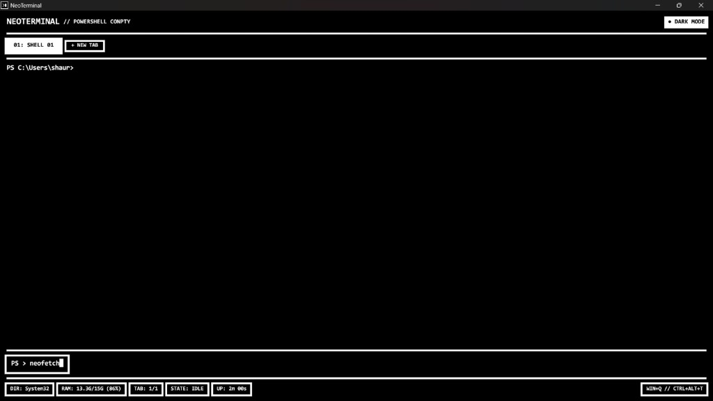
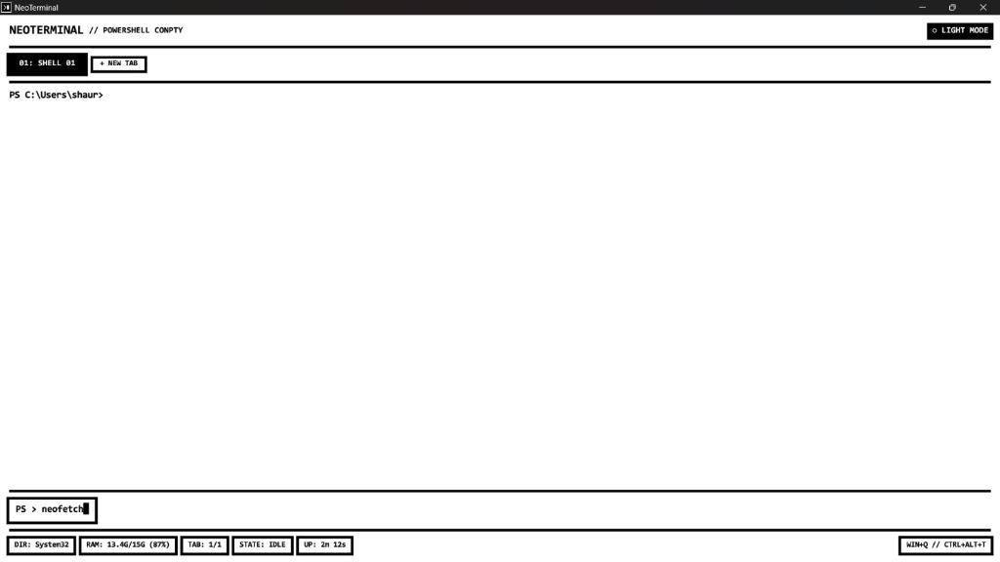
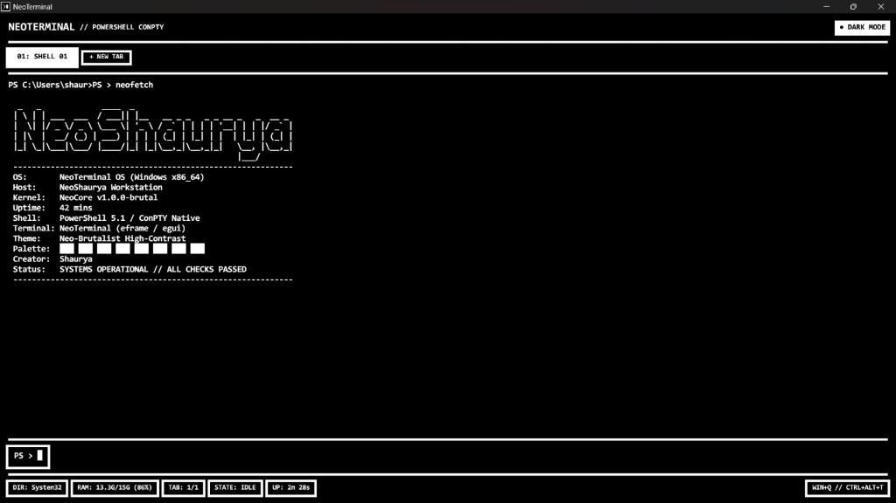

# NeoTerminal ⚡

> A high-performance native desktop terminal emulator built from scratch in **Rust**, powered by **Windows ConPTY** with an uncompromising, high-contrast **Neo-Brutalist design**.

---

## 📸 Screenshots

| Dark Mode (Multi-Tabs & Status Strip) | Light Mode (High Contrast) |
|:---:|:---:|
|  |  |

<p align="center">
  <b>Built-in <code>neofetch</code> Easter Egg with Custom ASCII Art & System Specs</b><br><br>
  
</p>

---

## 🛠️ Skills & Technologies Used

| Category | Details |
| :--- | :--- |
| **Core Languages** | **Rust** (100% native codebase) |
| **GUI Framework** | **eframe / egui** (Immediate-mode native GUI, Consolas Bold typography) |
| **Subsystems & APIs** | **Windows ConPTY** (`portable-pty`), **Win32 API** (`kernel32`), Low-Level Keyboard Hooks (`WH_KEYBOARD_LL`) |
| **Architecture** | Multithreaded reader channels (`std::sync::mpsc`), Mutex-guarded PTY writers, Sub-millisecond rendering |
| **Design System** | **Neo-Brutalism** (Uniform 4px borders, pure `#000000` / `#ffffff` palettes, zero corner rounding) |
| **Tooling & Build** | **Cargo**, **Rustc**, **MinGW-w64 (w64devkit)**, **PowerShell**, **Git & GitHub** |

---

## ✨ Features

- **Neo-Brutalist High-Contrast Aesthetics**:
  - **Dark Mode**: Pure black background (`#000000`), pure white text (`#ffffff`), and a **4px solid white border**.
  - **Light Mode**: Pure white background (`#ffffff`), pure black text (`#000000`), and a **4px solid black border**.
  - Sharp corners, thick geometric dividers, and bold brutalist controls.
  - Seamless one-click instant theme toggle (`[● DARK MODE]` / `[○ LIGHT MODE]`) in the top-right corner.
- **Brutalist Multi-Tabs**:
  - Spawn and manage multiple independent ConPTY shell sessions simultaneously.
  - Active tab highlighting, unread activity dot (`●`) for background tabs with new output.
  - Fast tab creation (`[ + NEW TAB ]`), individual close buttons (`×`).
  - Keyboard shortcuts:
    - **`Ctrl + T`**: Open new tab.
    - **`Ctrl + W`**: Close active tab.
    - **`Ctrl + Tab`** / **`Ctrl + Shift + Tab`**: Cycle through tabs.
    - **`Ctrl + 1`** to **`Ctrl + 9`**: Jump directly to tab 1 through 9.
  - Interactive tab renaming: type **`title <name>`** or **`rename <name>`** (e.g., `title Scraper`) to rename the active tab.
- **Bottom Status Strip (System & Git Telemetry)**:
  - Stark brutalist telemetry console along the bottom with uniform 4px borders.
  - **`DIR`**: Displays current directory name.
  - **`GIT`**: Auto-detects active Git branch (highlighted in inverted high contrast, e.g. `[ GIT: main ]`).
  - **`RAM`**: Live hardware memory usage and system load (e.g. `[ RAM: 7.2G/16G (45%) ]`).
  - **`TAB`**: Active and total tab count indicator (e.g. `[ TAB: 1/2 ]`).
  - **`STATE`**: Real-time process execution status (`[ STATE: IDLE ]` vs. high-contrast `[ STATE: BUSY ● ]` when output is streaming).
  - **`UP`**: Terminal session uptime counter (`[ UP: 12m 45s ]`).
  - Right-aligned quick hotkey hint pill (`[ WIN+Q // CTRL+ALT+T ]`).
- **PTY Shell Backend**:
  - Spawns the default system shell (`PowerShell`) via Windows ConPTY using `portable-pty`.
  - Non-blocking background worker thread using `std::sync::mpsc` streaming shell output into the GUI.
  - Reactive GUI repainting on incoming data with `ctx.request_repaint()`.
  - ANSI escape code parser and cleaner for clean, crisp typography.
- **Custom Input Field & Solid Block Cursor**:
  - High-contrast brutalist command dock at the bottom.
  - Custom solid block cursor **`█`** matching the active theme's foreground color.
  - Keystroke navigation: Left/Right caret movement, Backspace, Delete, Home, End.
  - Command history navigation (Up / Down arrow keys).
  - Terminal shortcuts (`Ctrl+C` interrupt signal, `Ctrl+L` clear screen).
- **Easter Eggs**:
  - **`neofetch`**: Intercepted before shell execution to display custom ASCII art for **NeoShaurya** with system statistics and brutalist color swatches.
  - **`sudo contact`**: Intercepted and blocked from execution. Prints `Access Granted. Redirecting to neoshaurya.com/contact...` and opens `https://neoshaurya.com/contact` in the browser.

---

## ⚡ Quick Launch Shortcuts

NeoTerminal integrates directly into Windows as a first-class desktop application:

1. **Global Shortcut Key**:
   - Press **`Ctrl + Alt + T`** anywhere on your PC to launch NeoTerminal instantly.
2. **Windows Run Dialog**:
   - Press **`Win + R`**, type **`neo`**, and hit **Enter**.
3. **Windows Search**:
   - Press **`Win + Q`**, type **`neo`**, and hit **Enter**.

---

## 🛠️ Project Structure

```
NeoTerminal/
├── assets/
│   ├── NeoTerminal.ico            # Windows Application Icon
│   └── screenshots/
│       ├── dark_mode.png          # Dark Mode (Tabs & Status Strip)
│       ├── light_mode.png         # Light Mode Preview
│       └── neofetch.png           # Custom Neofetch Easter Egg
├── .cargo/
│   └── config.toml                # Linker & build configuration
├── src/
│   ├── main.rs                    # Core GUI, PTY backend & theme engine
│   └── bin/
│       └── neohotkey.rs           # Global hotkey daemon
├── Cargo.toml                     # Dependencies (eframe, portable-pty)
├── Cargo.lock
└── README.md
```

---

## 🚀 Building from Source

### Prerequisites
- [Rust & Cargo](https://rustup.rs/) (1.75+)
- Windows 10 / 11

### Build & Run

Clone the repository and build with Cargo:

```powershell
git clone https://github.com/NeoShaurya/NeoTerminal.git
cd NeoTerminal

# Run in development mode
cargo run

# Build optimized release binary
cargo build --release
```

The compiled standalone executable is located at:
```
./NeoTerminal.exe
```
(or in `target/release/NeoTerminal.exe` after building)

---

## 📄 License

MIT © [Shaurya Chandra](https://neoshaurya.com)
